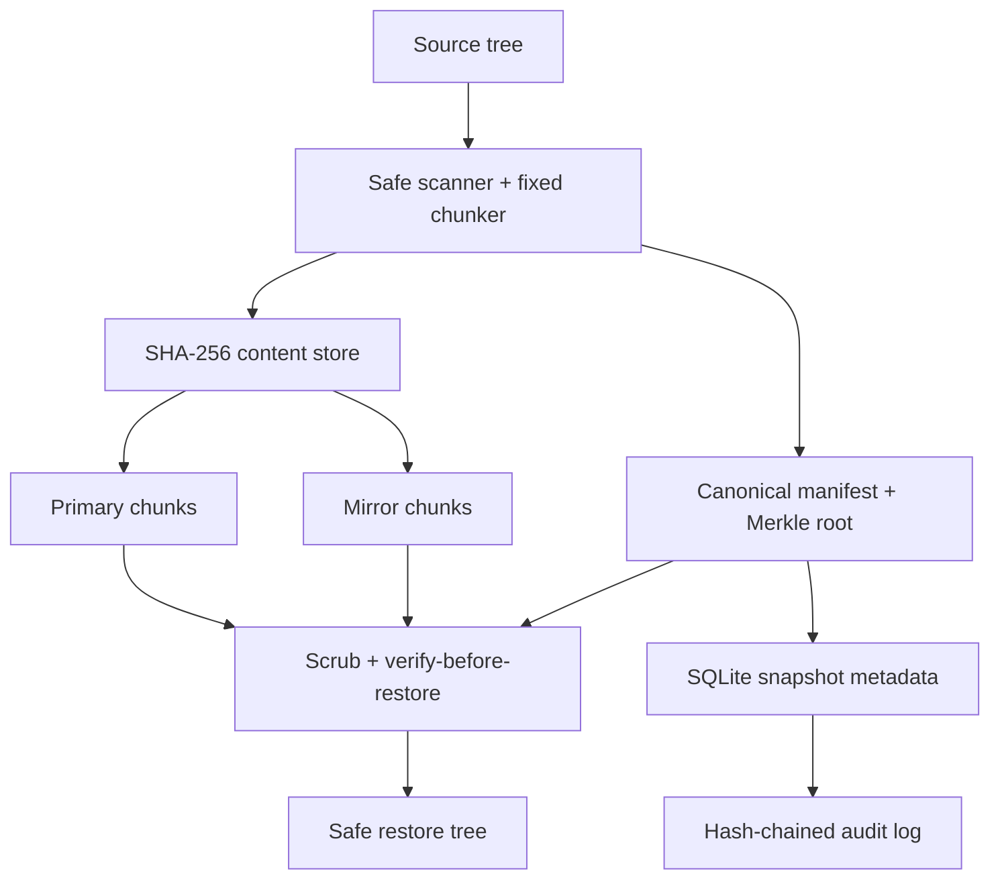

# VaultGuard

VaultGuard is a local, content-addressed backup repository that detects damaged backup chunks, repairs a primary copy from an independently stored mirror, verifies data before restore, and enforces a snapshot retention window. It is an **independent educational implementation inspired by a documented Rubrik engineering challenge**—not Rubrik software and not a claim of work performed for Rubrik.

The project is deliberately standard-library-only. Its end-to-end fault lab runs locally with synthetic data, no cloud account, no credentials, and no network calls.

## The documented company problem

Ransomware and storage faults can make a backup unusable precisely when the business needs it. A backup system therefore has to protect recovery data from mutation, continually prove its integrity, retain known-good versions, and demonstrate that bytes can actually be restored.

### What Rubrik documents (facts)

| Primary source | Documented fact used as context |
| --- | --- |
| [Rubrik: *Recovering Fast from Ransomware Attacks: The Magic of an Immutable Backup Architecture*](https://www.rubrik.com/blog/architecture/20/3/ransomware-recovery-immutable-backup-architecture) | Rubrik describes advanced ransomware targeting backups; append-only Patch Files; checksums at Patch Block, Stripe, and Chunk layers; periodic background checksum scans; and rebuilds using erasure coding. |
| [Rubrik: *Operationalizing Data Resiliency*](https://www.rubrik.com/blog/technology/2021/11/operationalizing-data-resiliency) | Rubrik says its filesystem uses CRC, stripe/chunk checksums, background scans, and fingerprints to protect against memory corruption, bit rot, system errors, and malicious activity. |
| [Rubrik: *Using Automation to Validate Applications and Services in Rubrik Backups*](https://www.rubrik.com/blog/products-solutions/17/1/automation-to-validate-in-rubrik-backups) | Rubrik argues that successful storage is not enough: an automated restore is the strongest validation that protected data is actually available. |
| [Rubrik documentation: *Retention-locked SLA Domain for cloud workloads*](https://docs.rubrik.com/en-us/saas/saas/rl_sla_cnp.html) | Rubrik documents retention lock as protecting snapshots from alteration or deletion for the SLA retention period. |

### What this project infers and designs independently

The sources establish the problem and useful properties; they do not prescribe this implementation. VaultGuard independently chooses SHA-256 content addressing, fixed-size chunks, JSON Merkle manifests, SQLite transactions, two local chunk copies, an audit hash chain, and a Python CLI. Its local “retention lock” is application-level policy enforcement—not Rubrik’s immutable filesystem, an object-store WORM guarantee, erasure coding, or a security boundary against a machine administrator.

## Why the problem matters

- Corrupt or encrypted recovery data can convert a recoverable outage into permanent data loss or a ransom decision.
- Silent bit rot makes “backup completed” a misleading success signal unless reads and restores are verified.
- Incremental retention can grow storage cost quickly; chunk-level deduplication avoids storing identical content repeatedly.
- A restore gate should fail closed when a manifest, chunk, or reconstructed file does not match its expected digest.

## Architecture



| Component | Responsibility |
| --- | --- |
| Safe scanner | Walks regular files deterministically; rejects source symlinks, special files, overlapping source/repository paths, and files that change while read. |
| Chunk store | Splits files into fixed-size chunks, addresses each by SHA-256, atomically writes a primary and mirror, and deduplicates across snapshots. |
| Manifest | Records ordered chunk references, whole-file digests, modes, mtimes, logical sizes, and a Merkle root in canonical JSON. The snapshot ID is derived from the manifest digest. |
| Metadata transaction | Commits snapshot metadata and chunk reference counts with SQLite `BEGIN IMMEDIATE`; manifests and content are write-once by normal application flow. |
| Scrubber | Recomputes primary chunk hashes, detects missing/truncated/modified data, validates the mirror, repairs atomically, and reconstructs every file hash. |
| Restore gate | Refuses to start unless full verification passes; rejects traversal and symlink destinations and never overwrites an existing file. |
| Retention policy | Blocks deletion before `retained_until`; after expiry it writes a tombstone and preserves content for auditability. |
| Audit chain | Hash-links mutation events and checks a stored head/count checkpoint to detect ordinary row edits, gaps, and tail truncation. |

## Reproduce it

Requirements: Python 3.11+; no third-party packages.

```bash
git clone https://github.com/psatyasaiganesh-oss/VaultGuard.git
cd VaultGuard
python -m unittest discover -v
python -m vaultguard demo
```

The deterministic demo performs two 3 MiB snapshots of 97 files, mutates a subset between versions, corrupts six primary chunks (bit flips and truncations), detects all six, repairs them from the mirror, restores the second snapshot, compares the restored tree fingerprint, rejects an early deletion, and verifies the audit chain.

The checked-in [demo result](reports/demo.json) and [validation report](reports/validation.json) contain measured results from the committed code. Expected deterministic content metrics (wall-clock duration naturally varies):

| Result | Measured value |
| --- | ---: |
| Tests | 50 passed |
| Logical bytes across two snapshots | 6,291,456 |
| Unique primary content | 458,752 bytes |
| Primary-store bytes avoided by deduplication | 5,832,704 (92.71%) |
| Physical bytes including the full mirror | 917,504 |
| Fault injection | 6/6 corrupt chunks detected; 6/6 repaired |
| Restore | 97 files / 3,145,728 bytes; exact tree fingerprint match |
| Retention and audit checks | Early delete blocked; audit chain valid |

These are synthetic local measurements, not production benchmarks or Rubrik performance claims. The unusually high deduplication ratio is intentional because the generated dataset repeats blocks heavily.

### Docker

```bash
docker build -t vaultguard .
docker run --rm vaultguard demo
```

The image runs its tests during build and runs the CLI as a non-root user.

## CLI walkthrough

```bash
# Create a repository.
python -m vaultguard init ./vault-repo --chunk-size 4096

# Snapshot a directory and retain it for one day.
python -m vaultguard backup ./vault-repo ./important-data \
  --label finance-share --retain-seconds 86400

# Use the returned snapshot_id.
python -m vaultguard list ./vault-repo
python -m vaultguard verify ./vault-repo SNAPSHOT_ID
python -m vaultguard scrub ./vault-repo --repair
python -m vaultguard restore ./vault-repo SNAPSHOT_ID ./recovered-data
python -m vaultguard audit ./vault-repo
python -m vaultguard stats ./vault-repo
```

Every command prints machine-readable JSON. Expected user/input failures also return structured JSON on stderr and exit with status 2; a completed integrity check that finds corruption exits with status 1.

## Correctness and security choices

- Canonical JSON and SHA-256 bind every manifest to its snapshot ID; the Merkle root binds its ordered file records.
- Verification covers manifest shape, totals, stored metadata digest, every unique primary chunk, reconstructed file sizes, and whole-file hashes.
- A mirror is trusted only after its length and SHA-256 match; repairs use write-fsync-rename-fsync ordering.
- Backup uses `O_NOFOLLOW` where supported and compares device, inode, size, and nanosecond mtime before and after each read.
- Restore accepts only canonical relative paths, rejects `..`, absolute paths and backslashes, checks path components for symlinks, creates files exclusively, and rehashes bytes during restore.
- SQLite mutation records and the audit chain update in one transaction. Database and content files default to owner-only permissions.
- Retention deletion never unlinks data in this prototype; it transitions a snapshot to a tombstone after the lock expires.

## Design tradeoffs

| Decision | Benefit | Cost / alternative |
| --- | --- | --- |
| Fixed 4 KiB chunks | Simple, deterministic recovery and fault injection | Insertions shift later boundaries; content-defined chunking would improve real incremental deduplication. |
| Full mirror | Straightforward recovery with a clear test oracle | 2× unique-content storage; production systems commonly use replication or erasure coding across failure domains. |
| Verify every file before restore | Strong fail-closed correctness | Reads repeated chunks more than once; a production scrubber would cache verification or stream a validated plan. |
| SQLite metadata | Durable local transactions with no service dependency | Single-host write coordination; a distributed control plane would need consensus and idempotent workflows. |
| Tombstones without garbage collection | Retains forensic evidence and avoids unsafe reference reclamation | Storage is never reclaimed; production GC needs leases, reachability analysis, and crash recovery. |

## Known limits and threat model

- This is a single-process local learning project, not a hardened backup appliance. A privileged OS user can modify code, both chunk copies, SQLite checkpoints, and manifests, so “immutability” is not a root-level security guarantee.
- The primary and mirror live on the same filesystem and therefore do not survive a shared disk or host failure.
- The audit head is not externally anchored or signed; an administrator capable of rewriting the whole database can forge a replacement chain.
- There is no encryption, compression, authentication, network service, malware classification, policy scheduler, external object lock, erasure coding, cluster consensus, garbage collection, or disaster-site replication.
- Snapshot consistency is per file, not application-consistent across a changing directory. Only regular files are captured; symlinks, devices, FIFOs, sockets, empty directories, ACLs, xattrs, and sparse extents are outside scope.
- A crash can leave unreferenced chunk or manifest files. They are safe but require a future mark-and-sweep tool to reclaim.
- Filesystem races are reduced but not eliminated; a production design would use descriptor-relative APIs and isolated mount namespaces.

## Interview material

Use [the focused interview walkthrough](docs/INTERVIEW.md) for a 6-minute explanation, failure scenarios, tradeoff questions, and evidence-based resume bullets.

## Project layout

```text
vaultguard/
  repository.py   transactional store, backup, scrub, repair, restore, retention
  util.py         canonical JSON, SHA-256/Merkle, safe paths, tree fingerprints
  demo.py         deterministic data generator and corruption/recovery lab
  __main__.py     JSON CLI
tests/            50 standard-library unit and integration tests
reports/          captured demo and validation evidence
Dockerfile        tested, non-root runtime image
```
